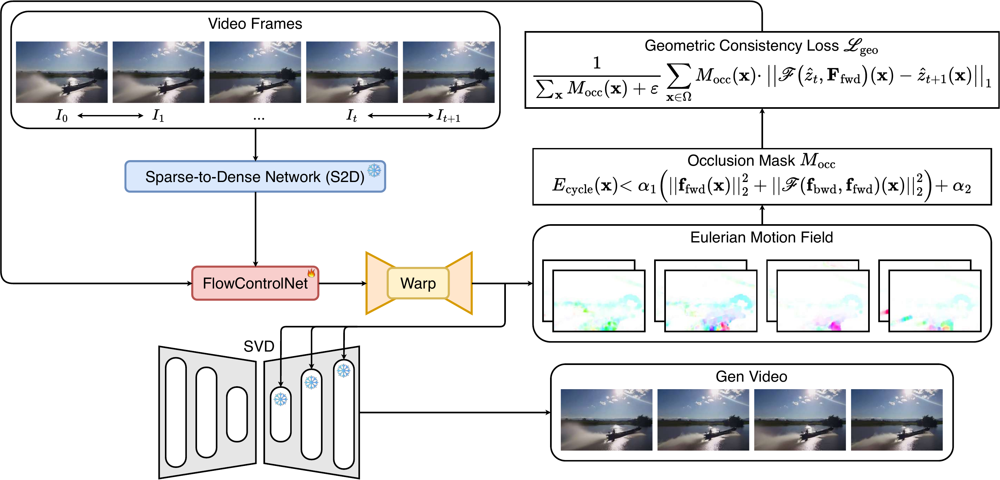

# Eulerian Motion Guidance (EMG)

[](https://arxiv.org/abs/2605.06280)
[](https://nguyentthong.github.io/eulerian/)
[](LICENSE)

Official implementation of **Eulerian Motion Guidance: Robust Image Animation via Bidirectional Geometric Consistency** (ACM Multimedia 2026).

[Paper](https://arxiv.org/pdf/2605.06280) | [arXiv](https://arxiv.org/abs/2605.06280) | [Project Page](https://nguyentthong.github.io/eulerian/)



EMG conditions a frozen Stable Video Diffusion backbone on *adjacent-frame Eulerian flows* rather than the more conventional reference-anchored Lagrangian flows.
A **Bidirectional Geometric Consistency (BGC)** loss enforces that the model's denoised latents respect the underlying optical flow.
The loss is masked by a forward-backward cycle test that excludes occluded regions automatically.
The result is sharper motion, fewer ghosting artifacts, and substantially better metric scores on WebVid-10M and CelebV-HQ.

## Repository layout

```
eulerian_motion_guidance/
├── configs/                      # YAML configurations
│   ├── default.yaml              # base config shared by every run
│   ├── trajectory_webvid.yaml    # Table 1
│   └── keypoint_portrait.yaml    # Table 2
├── src/emg/
│   ├── motion/                   # Eulerian flows, parallel batching, warping
│   ├── losses/                   # BGC loss and diffusion loss
│   ├── models/                   # S2D, FlowControlNet, MotionAdapter, RAFT, SVD
│   ├── data/                     # WebVid and portrait loaders, sparse hints
│   ├── training/                 # Trainer, EMA, LR schedulers
│   ├── inference/                # Eq. 13 autoregressive animator
│   ├── evaluation/               # metric suite and report generator
│   └── utils/                    # config, logging, distributed, visualization
├── scripts/                      # CLI entry points
├── tests/                        # pytest suite (CPU-only)
└── pyproject.toml                # Python 3.10 to 3.12
```

## Installation

We recommend [uv](https://docs.astral.sh/uv/), but plain pip works too.

```bash
# uv (fast, reproducible)
uv venv && source .venv/bin/activate
uv pip install -e ".[metrics,keypoints,logging,dev]"

# or plain pip
python -m venv .venv && source .venv/bin/activate
pip install -e ".[metrics,keypoints,logging,dev]"
```

The `metrics` extra pulls LPIPS, clean-fid, OpenCLIP, and InsightFace.
Skip it if you only want to train.
The `keypoints` extra pulls MediaPipe and face-alignment for portrait landmark extraction.

The default PyTorch wheels follow PyTorch's own index.
To target a specific CUDA version, add the matching index, for example `--extra-index-url https://download.pytorch.org/whl/cu124`.

## Pretrained weights

```bash
HF_TOKEN=hf_xxx python scripts/download_pretrained.py
```

This downloads SVD-XT through `huggingface_hub` and RAFT-Large through `torchvision`.
Both are stored in your default Hugging Face and torch caches.

## Datasets

### WebVid-10M (Table 1)

Shutterstock withdrew the original WebVid-10M URLs in 2024.
We do **not** redistribute videos.
The loader reads a CSV manifest and expects an MP4 directory that you assemble yourself.
Check how many manifest rows resolve to local files with:

```bash
python scripts/download_webvid.py \
    --manifest /data/webvid/manifest.csv \
    --video-root /data/webvid/videos \
    --json-out /data/webvid/health.json
```

The manifest schema is `videoid,name,contentUrl,duration,page_dir`.
Videos live at `{video_root}/{page_dir}/{videoid}.mp4` or `{video_root}/{videoid}.mp4`.

### VFHQ and CelebV-HQ (Table 2)

Both datasets are gated, so request them through their official channels.
The following command writes the URLs, licenses, and request procedures to a Markdown file:

```bash
python scripts/download_portrait.py --output ./portrait_data_info.md
```

## Training

Every script merges the given config on top of `configs/default.yaml`.
Trailing `key=value` arguments override any config entry.

### Single GPU

```bash
python scripts/train.py --config configs/trajectory_webvid.yaml \
    data.manifest=/data/webvid/manifest.csv \
    data.video_root=/data/webvid/videos
```

### Multi-GPU (DDP)

```bash
torchrun --nproc_per_node 4 scripts/train.py \
    --config configs/trajectory_webvid.yaml \
    data.manifest=/data/webvid/manifest.csv \
    data.video_root=/data/webvid/videos
```

## Evaluation

```bash
python scripts/evaluate.py \
    --config configs/trajectory_webvid.yaml \
    --checkpoint checkpoints/step_00100000.pt \
    --output eval_outputs/table1.json \
    --max-samples 1000
```

This writes `report.json` (machine-readable) and `table.md` (a Markdown table in the paper's format).
Use `Evaluator.merge_reports([...])` to combine several runs into one table.

| Table | Config | Metrics |
| --- | --- | --- |
| Table 1 (trajectory, WebVid) | `configs/trajectory_webvid.yaml` | LPIPS, FID, FVD, CLIP-Cons, E_warp |
| Table 2 (keypoints, CelebV-HQ) | `configs/keypoint_portrait.yaml` | CPBD, ArcFace, CLIP-Cons, E_warp |

## Single-image demo

```bash
python scripts/animate.py \
    --image inputs/portrait.png \
    --trajectories inputs/portrait_trajectories.json \
    --checkpoint checkpoints/step_00100000.pt \
    --config configs/keypoint_portrait.yaml \
    --output outputs/portrait.mp4
```

The trajectory file is JSON of the form:

```json
{
  "trajectories": [
    [{"x": 64, "y": 64, "u": 1.5, "v": 0.0}],
    [{"x": 64, "y": 64, "u": 1.5, "v": 0.0}]
  ]
}
```

Provide one list per adjacent frame pair, that is `T-1` lists for a `T`-frame video.
A single list is broadcast to all pairs.

## Development

```bash
pytest            # unit tests, CPU-only
ruff check .      # lint
ruff format .     # format
mypy              # strict type check of src/emg
```

## Citation

If you find this work useful, please cite:

```bibtex
@article{nguyen2026eulerian,
  title={Eulerian Motion Guidance: Robust Image Animation via Bidirectional Geometric Consistency},
  author={Nguyen, Thong and Le, Khoi M and Nguyen, Cong-Duy and Tuan, Luu Anh and Ng, See-Kiong and Miao, Chunyan},
  journal={arXiv preprint arXiv:2605.06280},
  year={2026}
}
```

## License

This project is released under the [Apache 2.0 License](LICENSE).

## Acknowledgements

This implementation builds on the following community releases:

- [Stable Video Diffusion XT](https://huggingface.co/stabilityai/stable-video-diffusion-img2vid-xt) by Stability AI, used as the frozen backbone.
- [RAFT](https://arxiv.org/abs/2003.12039) by Teed and Deng, used as the frozen flow estimator through the `torchvision` reimplementation with FlyingThings3D weights.
- [WebVid-10M](https://maxbain.com/webvid-dataset/) by Bain *et al.*, deprecated upstream as of 2024 and not redistributed by this repository.
